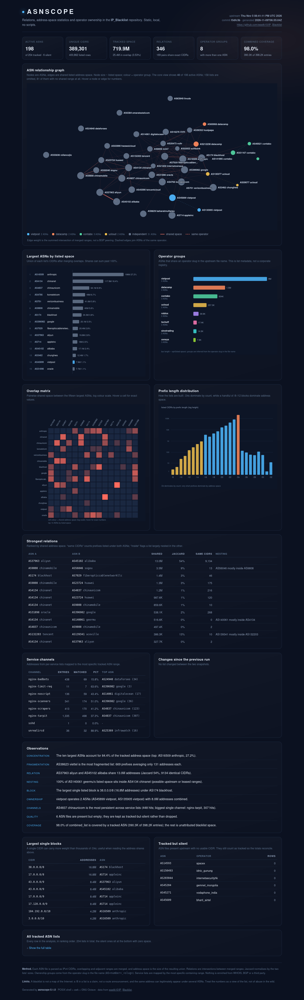

# ASNSCOPE

A local, static intelligence dashboard for [waelk10/IP_Blacklist](https://github.com/waelk10/IP_Blacklist):
it refreshes the repository, parses every ASN list, and draws the relations,
address-space statistics, and operator ownership that the raw files only hint at.



It is deliberately boring infrastructure: **POSIX shell + awk** for the data
path, **GNU Octave** for the drawings, and one **self-contained HTML file** as
the result. No Python, no JavaScript, no Node, no database, no server, no
external chart service.

## Why this shape

- **GNU/Linux first.** Tested on Ubuntu 24.04 with `mawk` 1.3.4 and GNU Octave
  8.4. The only non-base dependency is Octave; everything else is in a normal
  Unix userland.
- **One portable artefact.** `out/dashboard.html` embeds its CSS and all five
  SVGs. Copy it to a phone, a wiki, a mail attachment, or a static web root —
  it still renders. Hover tooltips are native SVG, not scripts.
- **Scriptable underneath.** All intermediate tables are TSV:
  `asn_stats.tsv`, `edges.tsv`, `owners.tsv`, `service_channel.tsv`,
  `delta.tsv`. Use them from `awk`, `join`, `sort`, or a spreadsheet.
- **No silent enrichment.** The tool only reads the upstream repository.
  Relations are intersections of *listed* ranges, not BGP peering; ownership
  groups come from the operator slug in the filename. That is a limitation,
  and the dashboard says so.

## Requirements

| Need | Notes |
|---|---|
| `sh`, `awk`, `sort`, `sed`, `git` | Any POSIX userland. `mawk`, `gawk`, and BSD `awk` are all fine. |
| GNU Octave ≥ 6 | `octave-cli` is preferred (headless). `octave` works too. |
| A browser | Only to *view* `dashboard.html`; not needed to generate it. |

On Debian/Ubuntu:

```sh
sudo apt install octave git
```

If Octave is not available, `./asnscope --no-viz` still produces the complete
TSV tables and the text briefing.

## Quick start

```sh
./asnscope                 # refresh + analyse + render
xdg-open out/dashboard.html
less out/report.txt
```

First run clones the upstream repository into `.cache/IP_Blacklist` (about
23 MB). Later runs do a shallow fetch and reset. If the network is down, the
cached clone is used with a warning.

```sh
./asnscope --offline       # never touch the network
./asnscope analyze         # parse the cached clone, rebuild tables + report
./asnscope render          # redraw from the existing tables
./asnscope report          # print the text briefing only
./asnscope refresh         # only clone/update the repository
```

Options:

```text
--repo URL     upstream git repository (default: waelk10/IP_Blacklist)
--out DIR      output directory (default: ./out)
--offline      use the cached clone, do not fetch
--no-viz       skip Octave, keep tables and report
-h, --help
```

Environment overrides: `ASNSCOPE_REPO`, `ASNSCOPE_CACHE`, `ASNSCOPE_OUT`.

## What it computes

1. **Parse.** Every `AS<number>_<slug>` file is read as IPv4 addresses/CIDRs.
   Malformed lines are skipped; duplicates inside an ASN are removed.
2. **Merge.** Each list is collapsed into disjoint address ranges. This is why
   `AS37963_aliyun` can have 98,954 listed prefixes but only 74 merged ranges.
3. **Union and overlap.** The union of all ASN ranges is the tracked address
   space. A second sweep measures how much space is claimed by two or more
   ASNs (and the maximum depth).
4. **Relations.** For every pair of lists, overlapping ranges give shared
   address space, a Jaccard score, and the count of identical CIDRs. A nesting
   ratio (share of A contained in a single B range) is reported separately —
   it is a hint at leased/downstream space, not proof of ownership.
5. **Ownership.** ASN files whose slug is the same (`contabo`, `censys`,
   `vietpost`, …) are grouped as one operator. This is metadata from the
   upstream file names, not a corporate registry.
6. **Service attribution.** Per-service lists (`nginx-tarpit`, `nginx-scanners`,
   `sshd`, …) are mapped to the most specific tracked ASN range. This gives a
   abuse-channel fingerprint per ASN and shows how much of each service list is
   attributable at all.
7. **Delta.** The current per-ASN table is compared with the previous run in
   `state/last_stats.tsv`: new, grown, shrunk, lost.
8. **Observations.** A small rule set turns the above into plain sentences:
   concentration, fragmentation, strongest relation, nesting, largest single
   block, owner group, channel persistence, empty files, coverage, change.

## Outputs

| File | Purpose |
|---|---|
| `out/dashboard.html` | Static dashboard, all CSS/SVG inline, no JavaScript. |
| `out/report.txt` | Plain-text briefing for terminals, mail, or `diff`. |
| `out/asn_stats.tsv` | Rank, ASN, operator, prefixes, ranges, addresses, share, degree, overlap. |
| `out/meta.tsv` | Slug/aliases and raw/merged counts per ASN, including empty lists. |
| `out/exact.tsv` | CIDRs that appear under two ASNs, with pair counts. |
| `out/edges.tsv` | `asn_a asn_b overlap jaccard pairs a_inside_b b_inside_a shared_cidrs`. |
| `out/owners.tsv` | All operator groups (the dashboard and report keep the multi-ASN ones). |
| `out/service_channel.tsv` | Per-channel entries, matched addresses, percentage. |
| `out/service_asn.tsv` | Channel × ASN hit counts. |
| `out/combined_asn.tsv` | How `combined_list` entries split across tracked ASNs. |
| `out/prefix_hist.tsv` | CIDR count and listed addresses by prefix length. |
| `out/big_prefixes.tsv` | Largest single CIDRs in the lists. |
| `out/empty.tsv` | ASN files present upstream but empty. |
| `out/delta.tsv` | Per-ASN change since the previous run. |
| `out/summary.tsv` | Key/value totals used by the report and dashboard. |
| `out/insights.tsv` | Generated observations. |
| `state/history.tsv` | One line per run (timestamp, ASNs, prefixes, union, overlap). |

## Reading the dashboard

- **Cards** — active/total ASNs, unique CIDRs, tracked space and overlap,
  relation count, multi-ASN operator groups, combined-list coverage.
- **ASN relationship graph** — the core view: the 30 largest ASNs, the 10 most
  connected, and every member of an operator group above 200 K addresses.
  Node size follows listed space, colour follows operator group, edge width
  follows shared space. 158 of 198 active lists are omitted to keep it
  readable; the complete relation set stays in `edges.tsv`.
- **Largest ASNs** — share of the union, with prefix counts.
- **Operator groups** — ASNs that share a slug; bar length is √space so the
  8 M and 8 K groups are both visible.
- **Overlap matrix** — the top 15 ASNs, log colour scale, hover for exact
  shared addresses and Jaccard.
- **Prefix length distribution** — why the address totals look the way they
  do: /24s dominate by count, a handful of /8–/12 blocks dominate by space.
- **Strongest relations** and **Service channels** — the tables behind the
  pictures.
- **All tracked ASN lists** — a collapsible full table, no JavaScript.

## What a run looked like

Snapshot of 2026-11-09 (upstream commit `f3dfc3b`):

- 204 ASN files, **198 with data**, 6 empty (`spacex`, `idnic_gunung`,
  `internetsecurityhk`, `gemnet_mongolia`, `vodaphone_india`, `bharti_airtel`)
- 400,862 listed prefix rows, **389,301 unique CIDRs**, 31,868 merged ranges
- **719.9 M addresses** in the union, **25.4 M (3.53 %)** claimed by 2+ ASNs,
  maximum depth 4
- **346 relation pairs**, 169 with identical CIDRs
- 8 operator groups with more than one ASN (vietpost, datacamp, contabo,
  ucloud, roblox, techoff, sinotrading, censys)
- 98.0 % of `combined_list` entries attributed to a tracked ASN
- top space: AS16509 anthropic 27.2 %, AS4134 chinanet 16.4 %,
  AS4837 chinaunicom 8.9 %
- strongest relation: aliyun ↔ alibaba, 13.0 M shared addresses,
  9,134 identical CIDRs

These numbers are a view of the list, not of the Internet. A `/8` in a
blacklist is a claim; two lists can legitimately contain the same range; big
cloud providers can dominate address totals through a handful of huge blocks.
The dashboard repeats this caveat in its footer.

## Layout

```text
asnscope              POSIX sh driver (refresh / analyze / render / report)
lib/extract.awk       AS* files -> flat CIDR table
lib/merge.awk         per-ASN disjoint ranges + metadata
lib/union.awk         union of all ranges
lib/depth.awk         area covered by 2+ ASNs
lib/exact.awk         CIDRs shared between ASNs
lib/edges.awk         pairwise intersections, Jaccard, nesting
lib/stats.awk         per-ASN summary joined with relations
lib/owners.awk        operator groups
lib/coverage.awk      service IP -> ASN by most specific range
lib/delta.awk         previous vs current snapshot
lib/insights.awk      plain-language observations
lib/render_dashboard.m  SVG panels and force layout (Octave)
lib/build_html.awk    inline CSS/SVG into one HTML file
lib/report.awk        text briefing
share/style.css       dashboard styles (inlined at build time)
state/                last snapshot + history (gitignored)
.cache/               upstream clone (gitignored)
out/                  generated output (gitignored)
```

## Performance

On the 399 K-row dataset above: analysis ≈ 17 s, Octave rendering ≈ 9 s
(includes a 760-iteration force layout), first clone excluded. The finished
dashboard is ~167 KB, of which the inline graph is ~112 KB.

## Extending

- Another visual panel: write a `draw_*` function in `lib/render_dashboard.m`
  and a marker in `lib/build_html.awk`. The data is already in TSV.
- Another statistic: add an awk pass in `analyze()`, publish the TSV, and read
  it in `build_html.awk` / `report.awk`.
- Another blacklist repo: `--repo URL`. It must keep the same
  `AS<number>_<slug>` + per-service file layout.
- Change the graph threshold (`gaddr > 2e5`, top 30) or the forced-layout
  constants in `force_layout`; everything is deterministic.

## Licence

ASNSCOPE is free software: you can redistribute it and/or modify it under
the terms of the **GNU Affero General Public License** as published by the
Free Software Foundation, either version 3 of the License, or (at your option)
any later version.

ASNSCOPE is distributed in the hope that it will be useful, but **without any
warranty**; without even the implied warranty of merchantability or fitness
for a particular purpose. See the GNU Affero General Public License for more
details.

You should have received a copy of the GNU Affero General Public License along
with this program in [`LICENSE`](LICENSE). If not, see
<https://www.gnu.org/licenses/>.

The upstream data and its documentation are a separate work and remain under
the upstream repository's licence (GNU Free Documentation License 1.3 at the
time of writing).
